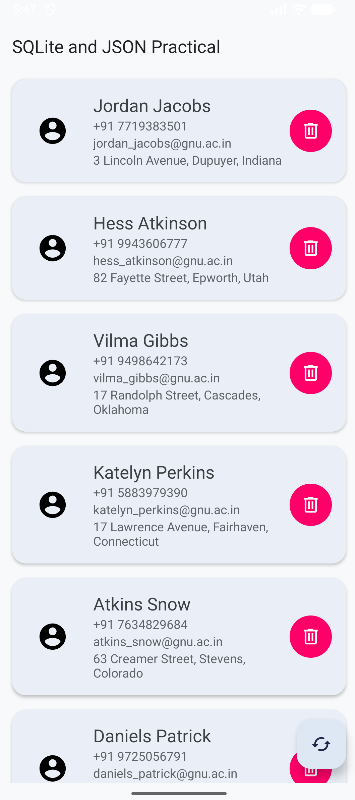

# Practical 7 – JSON and SQLite Database

## Aim
Develop an Android application that retrieves person data in JSON format from an internet API and stores the retrieved data in an SQLite database.

## Technologies Used
- Android Studio
- Kotlin
- XML
- SQLite Database
- JSON
- RecyclerView
- Kotlin Coroutines

## Description
This practical demonstrates how to retrieve person data from an internet API in JSON format, parse the JSON data, store it in an SQLite database, and display the stored records using RecyclerView.

## Features

### 1. Fetch Person Data
- Retrieves person data from an online JSON API.
- Uses an HTTP GET request to communicate with the web URL.
- Parses the received JSON data using `JSONArray` and `JSONObject`.

### 2. SQLite Database
- Stores retrieved person information in a local SQLite database.
- Uses `SQLiteOpenHelper` for database creation and management.
- Supports inserting, retrieving, and deleting person records.

### 3. RecyclerView
- Displays the stored person records in a scrollable list.
- Each person record displays:
  - Name
  - Phone Number
  - Email
  - Address

### 4. Delete Person
- Each person card contains a delete button.
- A person can be removed from the SQLite database and RecyclerView.

### 5. Refresh Data
- A Floating Action Button is provided to refresh the data.
- New data is fetched from the API and stored in the database.

## Output

### Main Screen




## Project Structure

```text
app/
└── src/
    └── main/
        ├── java/
        │   └── com.meshwi.a24012011109_mad_practical_7/
        │       ├── MainActivity.kt
        │       ├── DatabaseHelper.kt
        │       ├── HttpRequest.kt
        │       ├── Person.kt
        │       ├── PersonAdapter.kt
        │       └── PersonDBTableData.kt
        │
        ├── res/
        │   ├── layout/
        │   │   ├── activity_main.xml
        │   │   ├── item_person.xml
        │   │   └── single_item.xml
        │   │
        │   └── drawable/
        │       ├── circle_background.xml
        │       ├── baseline_account_circle_24
        │       ├── outline_delete_24
        │       └── round_cached_24
        │
        └── AndroidManifest.xml
